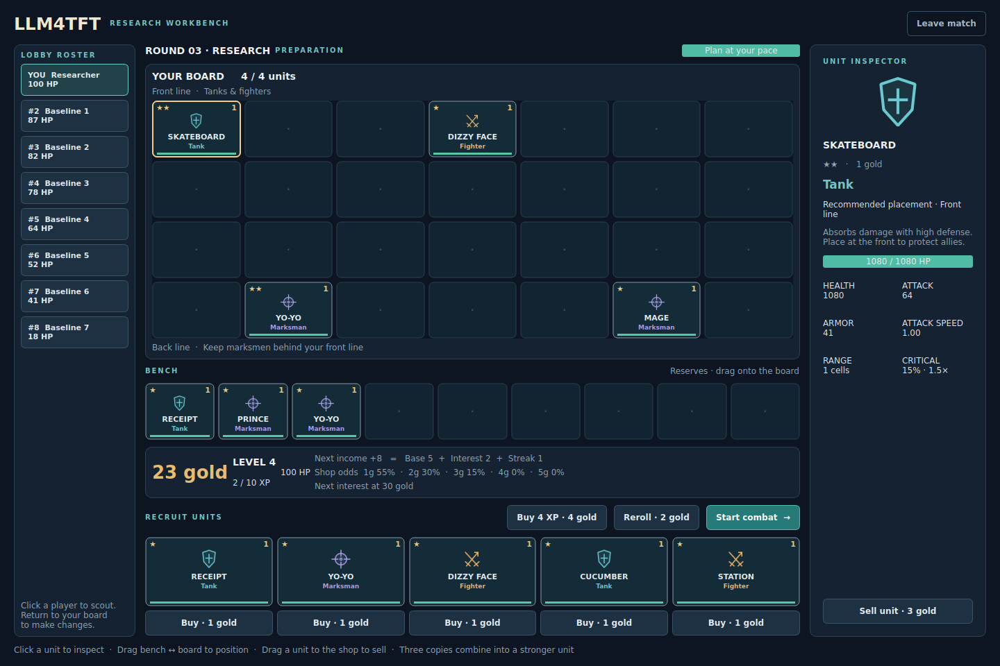
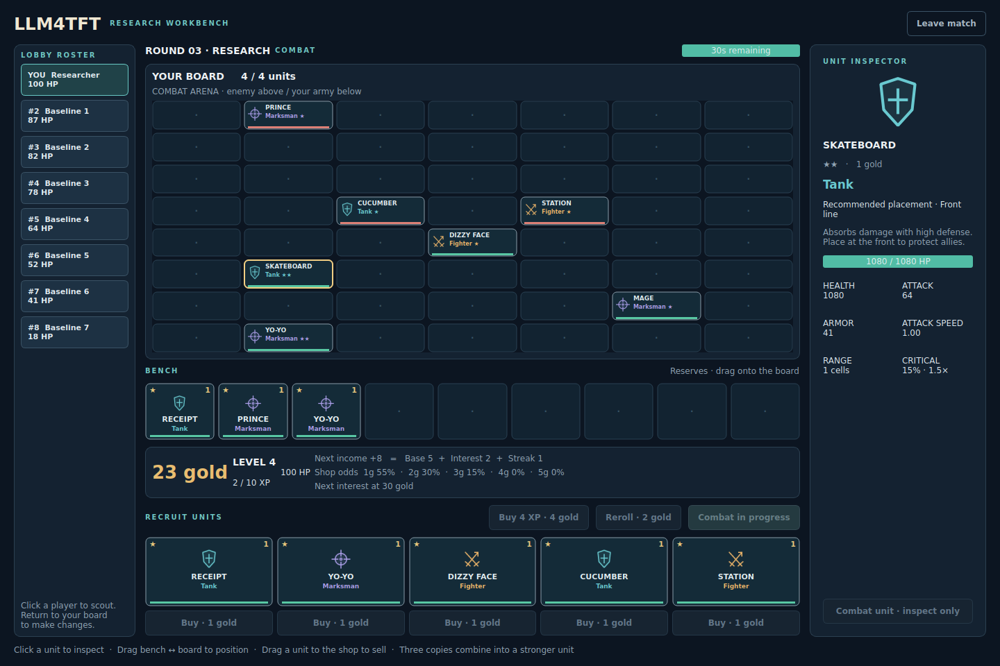

# LLM4TFT

A single-player autobattler workbench for human play, LLM experiments and decision data.
Forked from [JuwonHwang/LLM4Game](https://github.com/JuwonHwang/LLM4Game).



## Start playing

Install [uv](https://docs.astral.sh/uv/), then run:

```bash
uv sync --frozen
uv run python app.py
```

The app starts its own local server on an available loopback port, waits for it
and stops it on exit. There is no second terminal or API key requirement for play.
A graphical desktop is required for PyQt; headless research runs do not need one.

Enter a player name (letters, digits, `.`, `_`, `-`), create a match and start it.
Seven active scripted opponents fill the open seats. Buy units from the shop,
drag them between the bench and board, inspect their roles/stats, and press
**Start combat** when ready. Three copies of a unit combine into the next star
level. Drag an owned unit onto the shop or use its inspector button to sell.
Click a player in the roster to scout; return to your own board to make changes.

Preparation waits for your decision by default. This lets humans take their time
and keeps inference latency from becoming an accidental game penalty.

```bash
uv run python app.py --seed 7
uv run python app.py --timed               # automatic preparation timer
uv run python app.py --ruleset legacy      # original progression constants
uv run python app.py --server http://localhost:5000
```

Explicit `--server` connects to an existing server; the app does not start or stop
that process. Local `--seed`, `--ruleset`, `--timed` and `--data-dir` configure only
an owned server. Explicit server URLs replace the old `.server` file workflow in
the desktop launcher.

## Generate research data

A reproducible baseline needs no API key:

```bash
uv run python research_client.py --policy baseline --seed 7 --games 1
```

This runner starts and owns a **fast** server: combat uses the same fixed simulation
steps as desktop play, without wall-clock sleeps. Planning waits for the agent.
Games run sequentially; `--games` accepts 1–100. Local matches use the selected
seed. Distinct generated game IDs keep outputs separate; repeat with the same
seed and action sequence to reproduce the mechanical trajectory.

For an LLM-controlled player, set `OPENAI_API_KEY` in your environment and select
a model explicitly:

```bash
uv run python research_client.py --policy openai --model YOUR_MODEL --seed 7 --agent-log
```

The model must support Chat Completions JSON-object responses. The runner validates
its actions against the current observation, bounds retries and inference time,
and ends each preparation after at most 20 actions including the combat action.
It requests action JSON without reasoning. Optional `.agent.jsonl` files contain
prompts, model responses, token usage and latency. They contain no API credentials.

```bash
uv run python research_client.py --policy baseline --games 3 --data-dir /tmp/llm4tft-data
uv run python research_client.py --policy openai --model YOUR_MODEL --inference-timeout 60
uv run python research_client.py --server http://localhost:5000 --policy baseline
```

Remote research servers must use decision mode. Remote seed/speed/rules are server
configuration, not client overrides. A disconnected, interrupted or recording-limited
session is reported as a failed run rather than a completed experiment.

## Decision records

Runtime directories are created automatically under the repository, or under
`--data-dir`. Existing recordings are never overwritten.

| Path | Contents |
| --- | --- |
| `replay/<game_id>.decisions.jsonl` | Incremental metadata, player decisions and terminal outcome |
| `replay/<game_id>.json` | Completed match economy/action histories |
| `replay/<game_id>.agent.jsonl` | Optional model prompt, response, usage and latency records |
| `db/user.json` | Local player scores and bounded match history |
| `log/local-server.log` | Owned server startup output |
| `log/server.log` | Server diagnostics |

A decision row contains `player_id`, `round`, `phase`, the player's own
`observation`, `action` (`name`, `args`), `result` (`ok`, `message`) and
`next_observation`. The observation includes actual unit stats/roles and a scoped
`legal_actions` mask for economy/shop actions. Movement and sales require separate
occupancy checks. Invalid attempts are recorded as well.

Metadata records the seed, players, opponent policy, ruleset/version and timing
mode. The terminal row distinguishes completion, abandonment, interruption,
recording limit and server errors; its `privileged_final_state` is explicitly
separate from policy inputs. Training inputs should use `observation`, not the
inspector's full network snapshot or privileged final state. The headless runner
filters other players' private shops and benches before inference.

Journals flush after each row. They reserve terminal capacity and stop the session
before the configured recording limit can discard an applied player decision.
Default ceilings are 20,000 rows, 64 MiB per journal and 1 MiB per row. A disk-write
failure is surfaced and cannot guarantee a terminal row; inspect server logs.
Baseline bot actions are included in completed match histories; decision rows
record the connected player's actions.

## Economy and power progression

This is a simplified game with versioned rules, rather than an exact TFT ruleset.
Both profiles include engine correctness fixes; `legacy` preserves original
progression constants and is **not** a byte-for-byte reproduction of old results.

| Setting | `research` (default) | `legacy` |
| --- | --- | --- |
| Initial HP / level / gold | 100 / 2 / 3 | 30 / 1 / 0 |
| Free initial unit | One 1-cost unit | One 1-cost unit |
| Base income after successive combats | 2, 2, 3, 4, then 5 | 10 |
| Interest | `min(gold // 10, 5)` | Same corrected formula |
| Streak bonus | 2–3: +1; 4: +2; 5+: +3 | 2–6+: +2 through +6 |
| Combat win | +1 gold | +1 gold |
| Timed preparation / combat limit | 45s / 30s | 10s / 5s |
| Base loss damage | Increases every five rounds | 3 |
| Reroll / XP purchase | 2 gold / 4 gold for 4 XP | Same |

Surviving enemy units add to loss damage. Health and attack scale by 1.8 per star
upgrade. Attack speed is measured in attacks per simulation second; it no longer
depends on the server's frame rate. All shop draws, matchmaking and critical hits
use game-local seeded randomness. Scripted fillers buy, upgrade, level and position
their teams. Shared-pool ownership and elimination returns are enforced.

Tank, fighter and marksman labels describe the implemented physical-attack
mechanics. Spells, traits, augments and item combat effects are not implemented.
The initial research preset provides explicit, testable progression; broader
strategy balance still needs empirical calibration across policies and seeds.



## Standalone server and existing examples

```bash
uv run python server.py --seed 7                 # explicit planning; local port 5000
uv run python server.py --seed 7 --fast          # fast headless research
uv run python server.py --ruleset legacy --timed # older client experiments
uv run python console_client.py
```

Console commands include `login NAME`, `register ROOM`, `start` and `advance_round`.
The original `random_agent.py`, `llm_agent.py` and `exp.py` are historical examples;
use `research_client.py` for the supported single-player workflow and data format.
The old experiments require a separate timed server and their original API-key
configuration; their original prompts and research assumptions have not been
modernized.

## Development

```bash
uv sync --frozen
QT_QPA_PLATFORM=offscreen uv run pytest -q
uv run ruff check app.py server.py launcher.py recording.py research_client.py client tests
uv run ruff check pyautobattle/src/{astar,bench,field,game,player,pool,rules,shop,status,unit,util}.py
uv run mypy --follow-imports=silent app.py server.py launcher.py recording.py research_client.py client pyautobattle/src
```

Tests cover economy thresholds, RNG isolation, pool conservation, active opponents,
explicit planning, real Socket.IO sessions, process ownership/cleanup, recording
limits, private policy inputs, offline model-response validation and offscreen Qt
interaction. API behavior is tested with offline responses; the tests make no paid
model requests.
